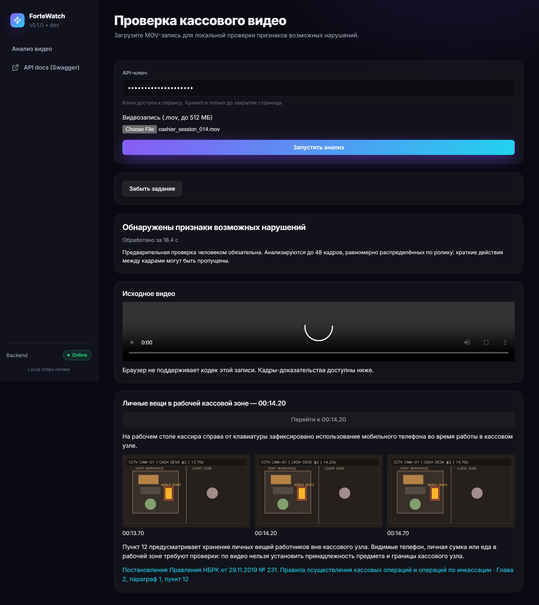

# ForteWatch — AI-сервис видеоконтроля кассовой дисциплины

Локальный AI-сервис для автоматизированного выявления визуальных признаков нарушений кассовой дисциплины по видеозаписям CCTV (кейс **ForteBank Datathon 26**). Сервис принимает `.mov` видеозаписи через веб-интерфейс и REST API, выполняет двухэтапный визуальный анализ на локальной мультимодальной модели **Qwen3.5-4B (Ollama)** без обращения к облачным сервисам и возвращает вердикт, таймкоды событий, стоп-кадры доказательств (JPEG/Base64) и ссылки на нормативные акты НБРК (`adilet.zan.kz`).

---

## Быстрый запуск в 1 команду

Требования: **Node.js 20.19+**, **Python 3.11+**, **Ollama** (установленный локально).

```bash
npm start
```

> **Что делает `npm start` автоматически:**
> 1. При первом запуске создаёт `.env`, виртуальное окружение `backend/.venv` и устанавливает все зависимости Backend/Frontend.
> 2. Генерирует локальные ключи `ANALYSIS_API_KEY` и `SECRET_KEY` в `.env` (если они ещё не заданы).
> 3. Проверяет доступность локального сервера Ollama (`http://127.0.0.1:11434`), при необходимости запускает `ollama serve` в фоне и проверяет/докачивает веса модели `qwen3.5:4b`.
> 4. Применяет миграции БД (`alembic upgrade head`), собирает production-фронтенд и запускает единый сервер на **`http://localhost:8000`**.

Альтернативные режимы запуска (также одной командой):

| Режим | Команда | Адрес UI / API |
| :--- | :--- | :--- |
| **Production (единый порт)** | `npm start` | UI и API: `http://localhost:8000` · Swagger: `http://localhost:8000/api/docs` |
| **Development (hot-reload)** | `npm run dev` | UI: `http://localhost:5173` · API: `http://localhost:8000/api/docs` |
| **Docker Compose** | `docker compose up --build` | UI и API: `http://localhost:8000` (включает локальный контейнер `ollama`) |

Для работы через веб-интерфейс скопируйте сгенерированный `ANALYSIS_API_KEY` из корневого файла `.env` в поле **«API-ключ»**, выберите `.mov`-файл и нажмите **«Запустить анализ»**.



---

## Архитектура и логика пайплайна

Решение построено по схеме с изолированным GPU-воркером, гарантирующим соблюдение 5-минутного SLA на обработку одного ролика (фактическое время на датасете — **от 15.4 до 73.3 с**, среднее — **35.7 с** на ноутбучной RTX 3050 6 GB).

```mermaid
flowchart LR
    Client["Веб-интерфейс / Жюри API"] -->|"POST /api/v1/analyze (.mov + X-API-Key)"| API["FastAPI + JobManager"]
    API -->|"Subprocess (timeout 280s)"| Worker["Изолированный воркер (worker.py)"]
    Worker -->|"VFR-safe OpenCV decode"| Sampler["Равномерный сэмплинг (до 48 кадров)"]
    Sampler -->|"Батчи по 8 кадров (3x3 сетка)"| Stage1["Этап 1: Proposal (Qwen3.5-4B)"]
    Stage1 -->|"Дедупликация (окно 6 с)"| Dedup["Кандидаты нарушений"]
    Dedup -->|"3 кадра 512px (до / пик / после)"| Stage2["Этап 2: Верификация (Qwen3.5-4B)"]
    Stage2 -->|"Подтверждённые события + НБРК № 231"| Result["result.json (JPEG base64 + таймкоды)"]
    Result --> API
    Client -->|"GET /api/v1/jobs/{job_id}"| API
```



### Ключевые этапы обработки видео:
1. **Приём и контроль очереди (`backend/app/features/analysis/service.py`)**:
   - Валидация расширения `.mov`, размера (до `MAX_UPLOAD_MB`, по умолчанию 512 МБ) и непустого тела.
   - Строгий семафор (`BoundedSemaphore(1)`) на один активный GPU-процесс: параллельные запросы во время анализа получают `429 Too Many Requests` с заголовком `Retry-After: 10`, что исключает накопление очереди и превышение 5-минутного лимита жюри.
   - Межпроцессная файловая блокировка (`.worker.lock`) и атомарная запись состояния (`atomic_json` с retry при временных блокировках ОС). Исходный `.mov`-файл автоматически удаляется сразу после завершения задачи.
2. **Устойчивое декодирование VFR MOV (`backend/app/features/analysis/worker.py`)**:
   - Равномерно извлекается до **48 кадров** по всей длительности ролика (включая финальные секунды).
   - Для видео с переменной частотой кадров (VFR), где индекс контейнера в конце ролика может давать сбой при `CAP_PROP_POS_FRAMES`, реализован каскадный откат на соседние пакеты и последовательное декодирование с возвратом реального таймкода декодера (`CAP_PROP_POS_MSEC`).
3. **Двухэтапный визуальный инференс (`Qwen3.5-4B`, `temperature=0, seed=7`)**:
   - **Этап 1 — Генерация кандидатов (Proposal)**: кадры группируются по 8 штук в хронологические контакт-листы с нанесёнными индексами `F0..F7` и таймкодами (с адаптацией пропорций под вертикальные и горизонтальные ролики). Модель возвращает строго типизированный JSON (`ModelResponse` через JSON Schema).
   - **Дедупликация**: повторные срабатывания одного и того же правила в пределах 6 секунд объединяются.
   - **Этап 2 — Независимая верификация (Verification)**: для каждого кандидата из исходного видео в повышенном разрешении (`512px`) извлекаются 3 кадра доказательства (для длящихся правил `cash_not_secured` и `cashier_leaves_client` берётся широкое окно `global_index ± 4` сэмпла; для локальных действий — `timestamp ± 0.5 с`). Вторая независимая проверка модели отсекает свыше 70% ложных кандидатов мелкой сетки.

---

## Соблюдение требований локальности и ограничений (Раздел 7 ТЗ)

| Требование ТЗ | Реализация в коде (`worker.py` / `service.py`) |
| :--- | :--- |
| **Полная локальность инференса** | Функция `check_local_model()` проверяет, что `OLLAMA_URL` указывает строго на loopback (`127.0.0.1`, `localhost`, `::1`), отвергает любые имена моделей с `cloud` или `/` и проверяет через `/api/show`, что у модели нет полей `remote_model` и `remote_host`. |
| **Работа без интернета (Air-gapped)** | Все HTTP-клиенты создаются с `trust_env=False` и `follow_redirects=False`. Нормативный справочник НБРК встроен в код (`rules.py`) и никогда не запрашивается из сети во время анализа. |
| **Запрет биометрии и аудио** | Аудиодорожка не декодируется (используется `cv2.VideoCapture` только по видеопотоку). Промпты и логика содержат прямой запрет на идентификацию лиц. |
| **Никаких выдуманных ссылок (Zero Hallucination Rules)** | Поле `rule_id` в JSON-схеме модели ограничено фиксированным `Literal` из 5 проверенных идентификаторов. Ссылки, пункты и формулировки подставляются детерминированно на сервере из `rules.py`. |

---

## Нормативная база РК и распознаваемые типы нарушений (Разделы 6 и 8 ТЗ)

В качестве основного нормативного источника исследовано и сопоставлено с визуально наблюдаемыми событиями:
- **Документ**: Постановление Правления Национального Банка Республики Казахстан от 29 ноября 2019 года № 231 «Об утверждении Правил осуществления кассовых операций и операций по инкассации банкнот, монет и ценностей в банках второго уровня, филиалах банков-нерезидентов РК, Национальном операторе почты и юридических лицах, исключительной деятельностью которых является инкассация банкнот, монет и ценностей».
- **Официальный источник**: [ИПС «Әділет» — V1900019680](https://adilet.zan.kz/rus/docs/V1900019680) ([официальная публикация PDF](https://kazpravda.kz/uploads/redactors/files/5e2ed7157da541580128021.pdf)).

| Код (`rule_id`) | Тип нарушения (`type`) | Структурный элемент НБРК № 231 | Что визуально детектируется на видео и принцип трактовки |
| :--- | :--- | :--- | :--- |
| `personal_items` | **Личные вещи в рабочей кассовой зоне** | Глава 2, параграф 1, пункт 12 | Кассир использует мобильный телефон, принимает пищу/напитки или размещает личную сумку/рюкзак на рабочей поверхности. Так как по видео нельзя установить точные границы кассового узла и принадлежность предмета, событие помечается для проверки человеком. |
| `cash_concealment` | **Перемещение наличных в личные вещи или одежду** | Глава 2, п. 3, пп. 7; пункт 14 | Видимое перемещение банкнот кассиром в карманы одежды или личную сумку (мимо кассового ящика/лотка). Служит индикатором риска нарушения сохранности наличных, не являясь автоматическим доказательством хищения. |
| `unattended_cash` | **Наличные оставлены без наблюдения кассира** | Глава 2, п. 3, пп. 7 | Неубранные банкноты остаются на доступной рабочей поверхности в момент, когда кассир физически покинул рабочее место. Соотносится с общим требованием обеспечения сохранности наличных денег. |
| `cash_not_secured` | **Наличные остаются на столе после ухода клиента** | Глава 2, параграф 2, пункт 20 | В хронологической серии кадров фиксируется уход клиента, при этом принятые банкноты остаются лежать открыто на столе вне закрывающихся устройств (в т.ч. при подходе следующего клиента). Требует сверки факта завершения операции в АБИС. |
| `cashier_leaves_client` | **Кассир покидает место во время обслуживания клиента** | Глава 2, параграф 2, пункт 22 | Кассовый работник физически покидает рабочее место, тогда как клиент остаётся ждать у кассового окна. Пункт 22 запрещает прекращение обслуживания и уход работника до завершения операции с клиентом. |

---

## API для проверки жюри (Раздел 10 ТЗ)

Все эндпоинты `/api/v1/*` защищены заголовком `X-API-Key` (значение задаётся в `.env` переменной `ANALYSIS_API_KEY`). При отсутствии или неверном ключе возвращается `401 Unauthorized`.

### 1. Отправка видео на анализ — `POST /api/v1/analyze`

```bash
curl -X POST http://localhost:8000/api/v1/analyze \
     -H "X-API-Key: <ANALYSIS_API_KEY>" \
     -F "file=@video_017.mov"
```

Ответ (`202 Accepted`):
```json
{
  "job_id": "3f2a9c1e8b4d4c2a9f0e1d2c3b4a5f6e",
  "status": "processing",
  "progress": 0,
  "stage": "accepted"
}
```

### 2. Получение статуса и результата — `GET /api/v1/jobs/{job_id}`

```bash
curl http://localhost:8000/api/v1/jobs/3f2a9c1e8b4d4c2a9f0e1d2c3b4a5f6e \
     -H "X-API-Key: <ANALYSIS_API_KEY>"
```

Ответ после завершения (`200 OK`):
```json
{
  "job_id": "3f2a9c1e8b4d4c2a9f0e1d2c3b4a5f6e",
  "status": "done",
  "progress": 100,
  "stage": "complete",
  "elapsed_sec": 24.7,
  "verdict": "violation",
  "violations": [
    {
      "type": "Личные вещи в рабочей кассовой зоне",
      "timecode_sec": 14.2,
      "description": "На рабочем столе кассира справа от клавиатуры видно использование мобильного телефона.",
      "evidence_frames": [
        { "timestamp_sec": 13.7, "image_base64": "/9j/4AAQ..." },
        { "timestamp_sec": 14.2, "image_base64": "/9j/4AAQ..." },
        { "timestamp_sec": 14.7, "image_base64": "/9j/4AAQ..." }
      ],
      "rule": {
        "id": "personal_items",
        "title": "Личные вещи в рабочей кассовой зоне",
        "document": "Постановление Правления НБРК от 29.11.2019 № 231. Правила осуществления кассовых операций и операций по инкассации",
        "section": "Глава 2, параграф 1, пункт 12",
        "url": "https://adilet.zan.kz/rus/docs/V1900019680",
        "rationale": "Пункт 12 предусматривает хранение личных вещей работников вне кассового узла..."
      }
    }
  ],
  "model": "qwen3.5:4b",
  "sampled_frames": 30,
  "duration_sec": 29.0,
  "limitations": "Предварительная проверка человеком обязательна..."
}
```

---

## Результаты проверки на датасете и известные ограничения

Полный прогон на 42 видеозаписях из архива `open.zip` через реальный HTTP API (`scripts/evaluate_dataset.py`, без использования имен файлов или меток при инференсе):

| Показатель | Значение | Комментарий |
| :--- | :--- | :--- |
| **Успешно обработано (SLA < 5 мин)** | **42 / 42 (100%)** | 0 ошибок (`failed = 0`), все JPEG-доказательства валидированы |
| **Время обработки 1 видео** | **15.4 – 73.3 с** (среднее **35.7 с**) | Запас по времени в 4–8 раз относительно лимита 300 с |
| **Полнота обнаружения нарушений (Recall)** | **77.27% (17 / 22)** | Приоритет ТЗ (FAQ п. 16): минимизация пропуска нарушений |
| **F1-мера / Точность вердикта** | **F1: 64.15%** / Accuracy: **54.76% (23 / 42)** | TP: 17, TN: 6, FP: 14, FN: 5 |
| **Точность локализации (в пределах ≤ 2 с)** | **7 роликов** (минимальная ошибка **0.23 с**) | MAE по 17 найденным положительным роликам: **9.53 с** |

Подробная таблица по каждому из 42 видео приведена в [`docs/evaluation.md`](docs/evaluation.md), описание архитектуры API — в [`docs/analyze-api.md`](docs/analyze-api.md), результаты экспериментов с верификатором — в [`docs/detector-trials.md`](docs/detector-trials.md), сценарий демонстрации — в [`docs/demo-runbook.md`](docs/demo-runbook.md).

### Ограничения решения и известные случаи ошибок:
1. **Дискретизация по времени**: воркер анализирует до 48 равномерно распределённых кадров на ролик — очень короткие жесты между сэмплами могут быть пропущены.
2. **Визуальная неоднозначность верхнего ракурса CCTV**: компактная локальная модель `Qwen3.5-4B` при взгляде сверху иногда принимает поворот кресла кассира или движение клиента у стойки за уход кассира (`cashier_leaves_client`), а белые листы/квитанции — за оставленные купюры (`cash_not_secured`).
3. **Отсутствие данных банковских систем (АБИС)**: по видео невозможно определить статус проводки в системе, сумму наличных и полномочия сотрудников, поэтому вердикт сервиса всегда носит характер предварительного индикатора для ревью человеком.

---

## Тестирование и самопроверка

```bash
npm test          # 57 автотестов pytest (API, воркер, VFR-декодер, блокировки, метрики)
npm run lint      # ruff check + TypeScript tsc --noEmit
npm run build     # production-сборка React/Vite
```
